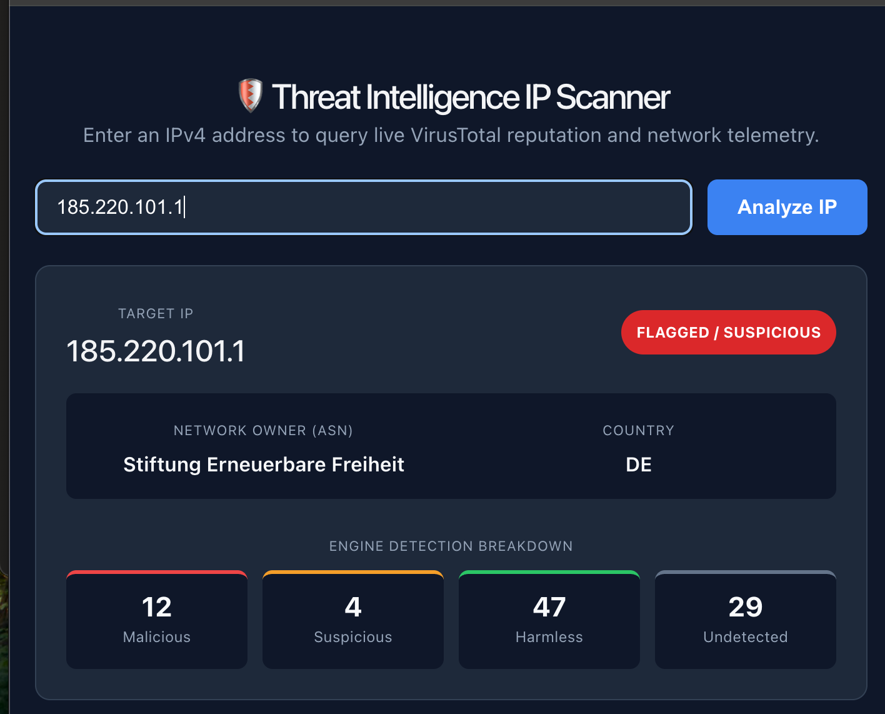
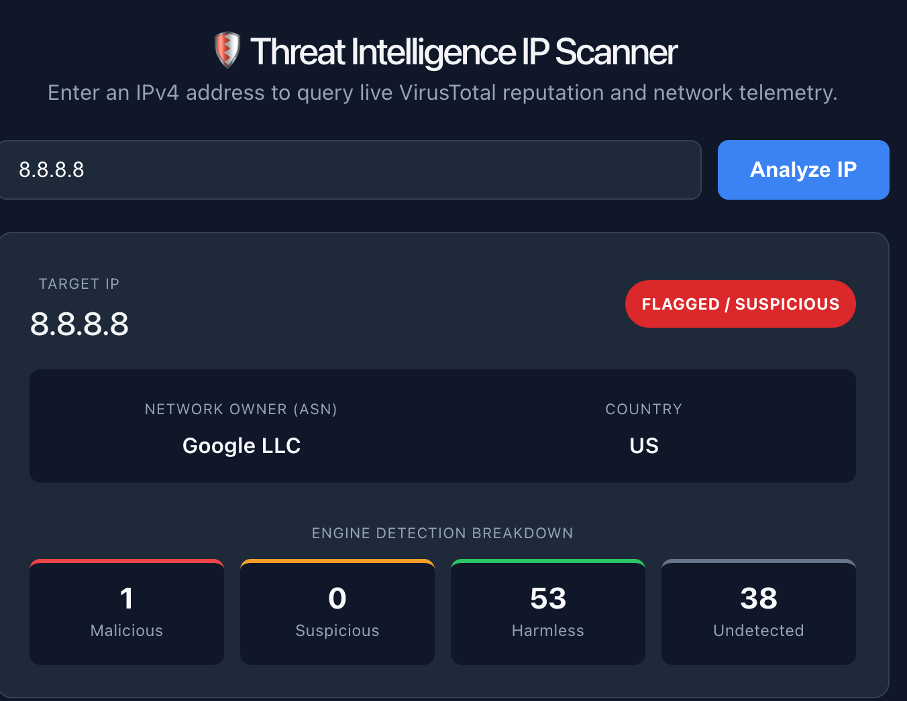
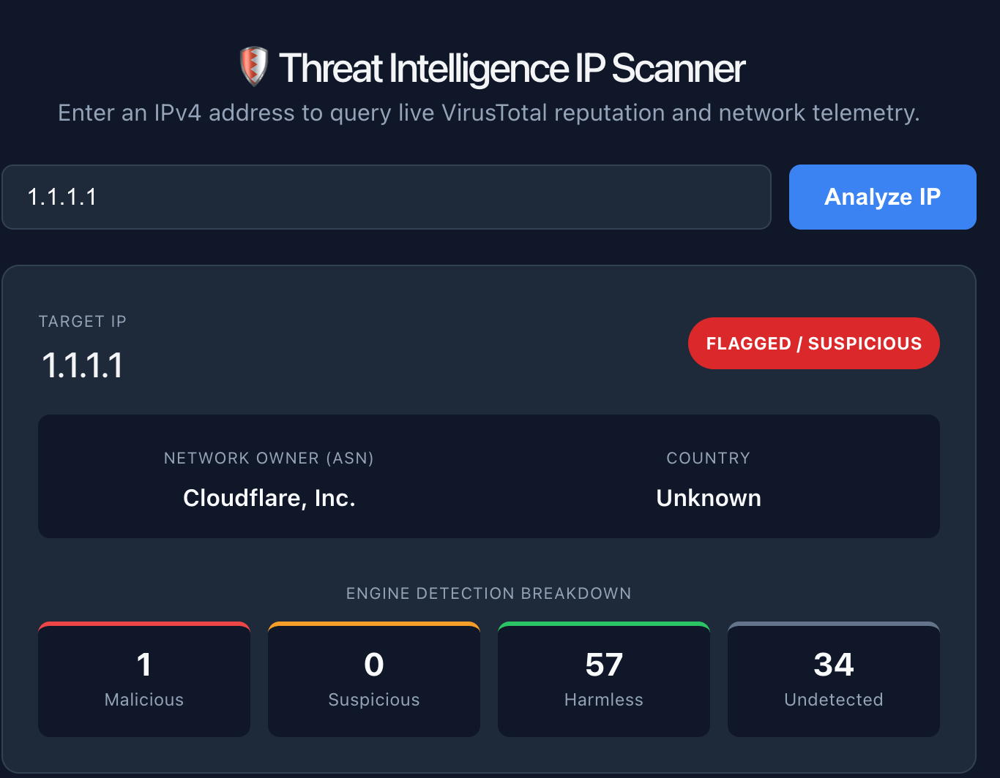
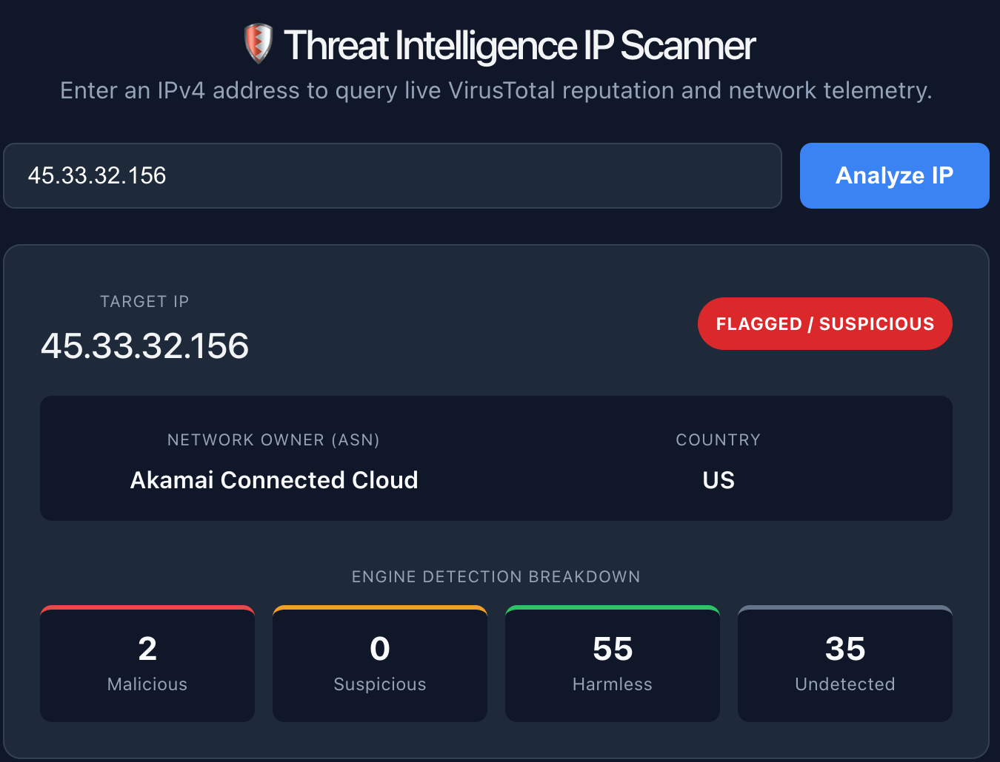

# 🛡️ Threat Intelligence IP Scanner

A full-stack security automation tool that streamlines IP reputation triage by querying the VirusTotal v3 API through a Python FastAPI backend and rendering real-time risk telemetry in a React dashboard.

### Flagged Threat Detection (`185.220.101.1`)

### Clean IP Lookup (`1.1.1.1`)

### Public DNS Resolver Check (`8.8.8.8`)

### Security Scanner Host Check (`42.33.32.156`)

## 🎯 Why I Built This
As a former SOC Analyst and Sysadmin, manual IOC (Indicator of Compromise) enrichment across multiple browser tabs slows down incident triage. This tool automates IP lookups into a single clean interface.

## 🛠️ Tech Stack
* **Backend:** Python, FastAPI, HTTPX, Python-Dotenv
* **Frontend:** React, Vite, JavaScript (ES6+)
* **Threat Intel API:** VirusTotal REST API v3

## 🚀 Key Features
* Real-time IPv4 reputation scoring (`Malicious`, `Suspicious`, `Harmless`, `Undetected`)
* Automated ASN (Network Owner) and Geolocation metadata extraction
* Decoupled REST API architecture with CORS support and environment-based secret management.
